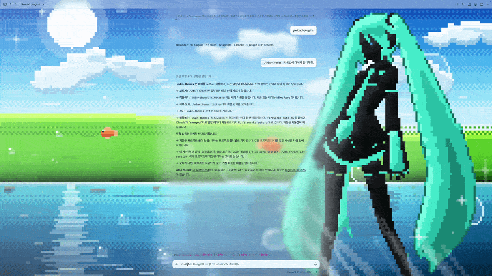

# 🌀 w0n-themes

Custom themes for the Claude desktop app, as a mod.

---
## Theme list

#### ✔️ Miku Aero

A light theme. A Frutiger Aero sky drawn as pixel art, with a Miku standing in it.



---

## Install

In Claude Code, add this repository as a marketplace and install the plugin from it:

```
/plugin marketplace add 0w0n2/w0n-themes
/plugin install w0n-themes@0w0n2
```

Or from a terminal:

```bash
claude plugin marketplace add 0w0n2/w0n-themes
claude plugin install w0n-themes@0w0n2
```

Then restart the desktop app.

## Usage

```
/w0n-themes                        # open the theme picker
/w0n-themes miku-aero              # apply a theme by name
/w0n-themes miku-aero session      # apply it for this session only
/w0n-themes off                    # clear the theme

/w0n-themes fireworks              # one firework show over the current theme
/w0n-themes fireworks auto on      # a show whenever Claude says "merged" (off by default)
/w0n-themes fireworks auto off     # stop that
```

A theme is remembered per project folder.
